# 🏛️ News Summarizer SaaS - 프론트엔드 아키텍처 및 상세 개발 로드맵

본 문서는 AI 기반 맞춤형 뉴스 요약 SaaS 플랫폼의 프론트엔드 프로젝트(Next.js App Router) 구축, 컴포넌트 설계, 백엔드 API 연동, 그리고 **페이즈별 상세 개발 프로세스**를 정의합니다.

---

## 📂 1. 전체 디렉토리 구조 (Monorepo `frontend/`)

```text
news-summarizer/
├── app/                      # 🐍 FastAPI 백엔드
├── requirements.txt
├── BACKEND_ARCHITECTURE.md
├── FRONTEND_ARCHITECTURE.md  # 👈 본 프론트엔드 아키텍처 문서
├── docker-compose.yml        # 백엔드 + 프론트엔드 통합 도커 오케스트레이션
└── frontend/                 # ⚛️ Next.js 14+ (App Router) 프론트엔드
    ├── .env.local            # 환경 변수 (NEXT_PUBLIC_API_URL 등)
    ├── package.json          # 프론트엔드 의존성 목록
    ├── tailwind.config.js    # Tailwind CSS 및 브랜드 컬러 설정
    ├── tsconfig.json         # TypeScript 설정
    ├── app/                  # 앱 라우터 (App Router)
    │   ├── layout.tsx        # 루트 레이아웃 (Pretendard 폰트, 테마 프로바이더)
    │   ├── page.tsx          # 루트 진입점 (로그인 여부 분기)
    │   ├── (auth)/           # 인증 관련 라우트 그룹
    │   │   ├── login/
    │   │   │   └── page.tsx  # 로그인 페이지 (sample/LOGIN.html 기반)
    │   │   └── signup/
    │   │       └── page.tsx  # 회원가입 페이지 (sample/SIGNUP.html 기반)
    │   ├── (dashboard)/      # 메인 서비스 대시보드 그룹 (사이드바 & 헤더 공유)
    │   │   ├── layout.tsx    # 대시보드 공통 레이아웃 (Navbar, Sidebar, 프로필 드롭다운)
    │   │   ├── feed/
    │   │   │   └── page.tsx  # 맞춤 뉴스 피드 대시보드 (sample/MAIN.html 피드)
    │   │   ├── clusters/
    │   │   │   └── page.tsx  # 주요 이슈 클러스터 트렌딩 뷰
    │   │   ├── bookmarks/
    │   │   │   └── page.tsx  # 북마크 보관함 뷰
    │   │   ├── settings/
    │   │   │   └── page.tsx  # 사용자 선호도(카테고리/키워드) 설정
    │   │   └── admin/
    │   │       └── sources/
    │   │           page.tsx  # RSS 소스 및 수집 관리 (관리자용)
    │   └── articles/
    │       └── [id]/
    │           └── page.tsx  # 독립형 기사 상세 페이지 (sample/ARTICLE.html 기반)
    ├── components/           # 재사용 가능한 UI 컴포넌트
    │   ├── Navbar.tsx        # 상단 네비게이션 & 프로필 드롭다운 메뉴
    │   ├── Sidebar.tsx       # 좌측 메뉴 & 카테고리 필터
    │   ├── ArticleCard.tsx   # 피드용 뉴스 카드 컴포넌트
    │   ├── ArticleModal.tsx  # 요약 빠른보기 모달
    │   └── Toast.tsx         # 알림 토스트 컴포넌트
    └── lib/
        ├── api.ts            # FastAPI 백엔드 통신용 Axios 인스턴스
        └── store.ts          # Zustand 전역 상태 관리 (Auth 및 선호도)
```

---

## 🗺️ 2. 페이지 라우트 및 API 매핑 명세

| 경로 (Path) | 컴포넌트 소스 | 주요 역할 및 기능 | 연동 FastAPI 엔드포인트 |
| :--- | :--- | :--- | :--- |
| `/` | `app/page.tsx` | 랜딩 및 로그인 상태 분기 | - |
| `/auth/login` | `app/(auth)/login/page.tsx` | 로그인 (이메일/비밀번호) | `POST /api/v1/auth/login` |
| `/auth/signup` | `app/(auth)/signup/page.tsx` | 회원가입 (비밀번호 확인 검증 포함) | `POST /api/v1/auth/register` |
| `/feed` | `app/(dashboard)/feed/page.tsx` | 맞춤형 AI 요약 뉴스 피드 및 실시간 검색 | `GET /api/v1/users/feed`, `GET /api/v1/articles` |
| `/clusters` | `app/(dashboard)/clusters/page.tsx` | Jaccard 유사도 기반 이슈 클러스터 탐색 | `GET /api/v1/articles/clusters` |
| `/bookmarks` | `app/(dashboard)/bookmarks/page.tsx` | 스크랩한 기사 보관함 관리 | `GET /api/v1/users/bookmarks` |
| `/settings` | `app/(dashboard)/settings/page.tsx` | 관심 카테고리 및 키워드 설정 | `GET/PUT /api/v1/users/preferences` |
| `/admin/sources` | `app/(dashboard)/admin/sources/page.tsx` | RSS 소스 CRUD 및 수동 수집 트리거 | `GET/POST/PUT/DELETE /api/v1/sources`, `POST /api/v1/ingestion/trigger` |
| `/articles/[id]` | `app/articles/[id]/page.tsx` | 독립형 기사 심층 독서 및 공유 페이지 | `GET /api/v1/articles/{article_id}` |

---

## 🏛️ 3. 화면 구현 및 UI 프리뷰

본 섹션에서는 뉴스 요약 SaaS 플랫폼의 주요 화면별 UI 구현 결과와 디자인 특징을 정리합니다. 모든 화면은 Tailwind CSS를 활용해 반응형(Responsive) 레이아웃과 다크 모드(Dark Mode)를 지원하도록 설계되었습니다.

### 3.1 인증 (Authentication)
- **로그인 화면 (`/auth/login`)**: 이메일 및 비밀번호 입력, 유효성 검증 및 JWT 토큰 저장 연동.
  - 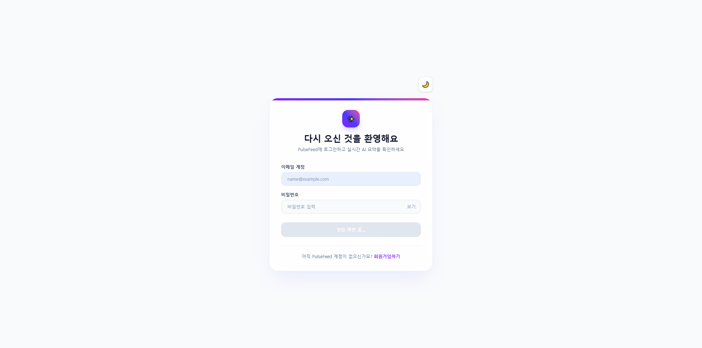
- **회원가입 화면 (`/auth/signup`)**: 이메일 형식 검증, 6자 이상 비밀번호 및 확인 일치 여부 체크.
  - 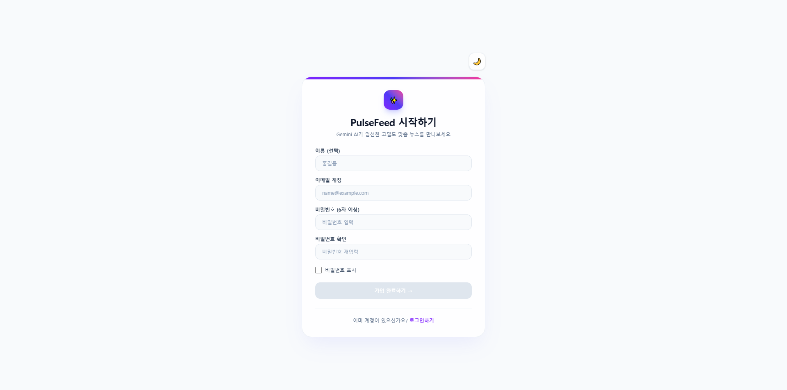

### 3.2 메인 대시보드 및 피드 (Dashboard & Feed)
- **메인 랜딩 / 피드 뷰 (`/feed`)**: Google Gemini AI 3줄 요약 카드, 실시간 검색, 카테고리 필터 및 무한 스크롤.
  - 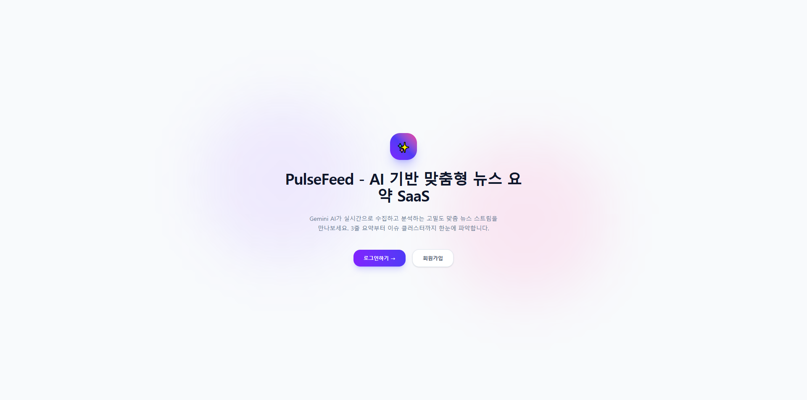
  - 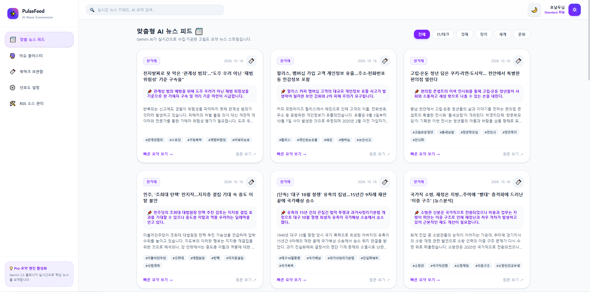
  - 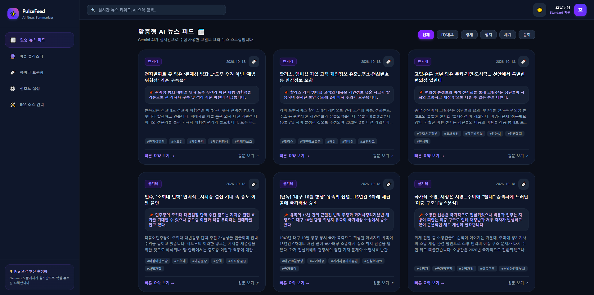
  - 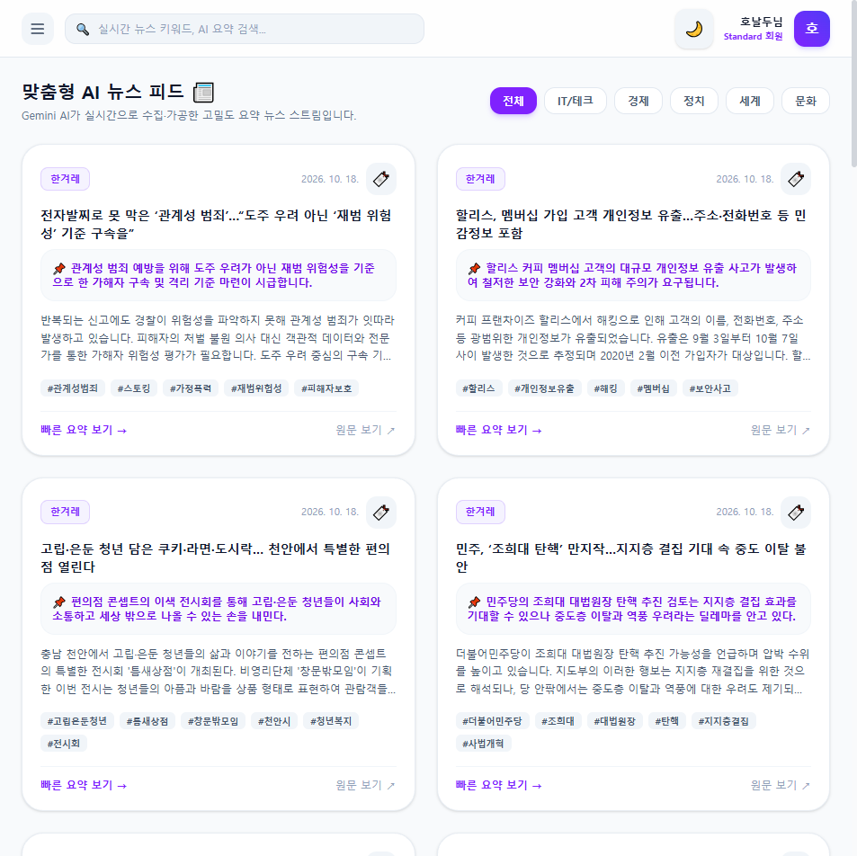
- **사이드바 내비게이션 (`Sidebar`)**: 메뉴 이동 및 카테고리별 빠른 필터링.
  - 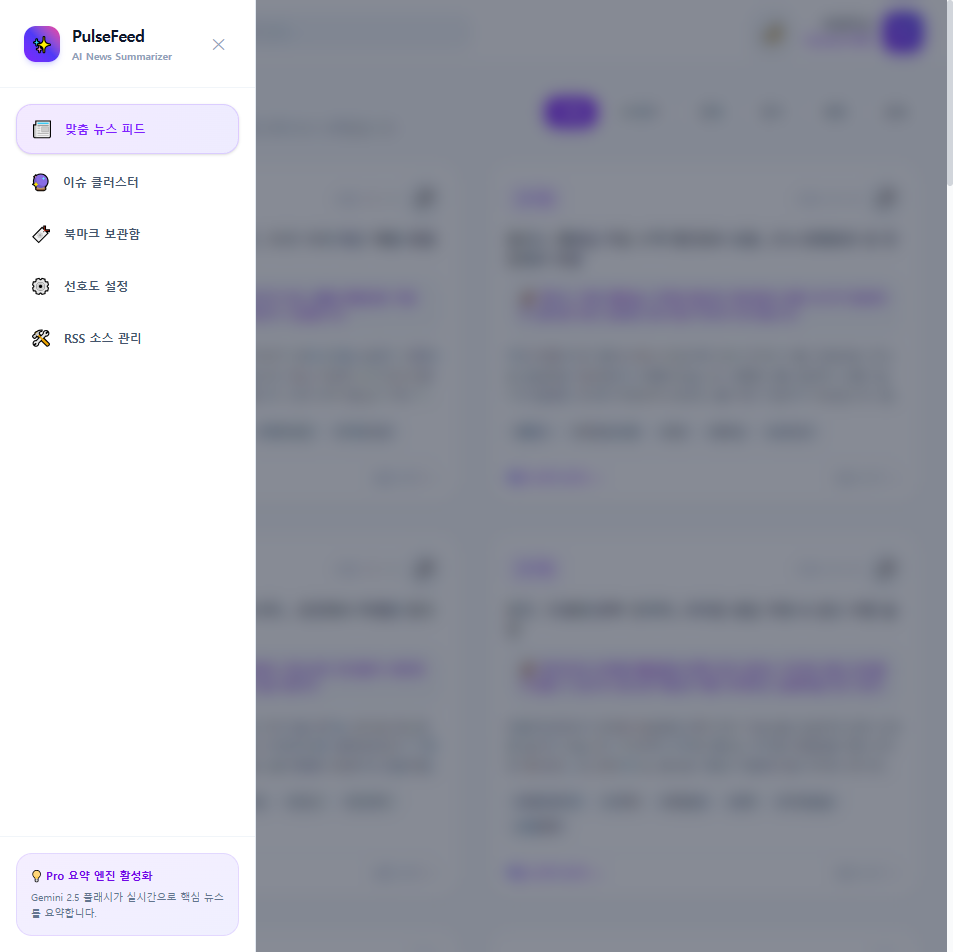

### 3.3 핵심 기능 및 관리자 뷰 (Features & Admin)
- **이슈 클러스터링 뷰 (`/clusters`)**: Jaccard 유사도 기반으로 연관 뉴스들을 그룹화하여 트렌드 파악.
  - 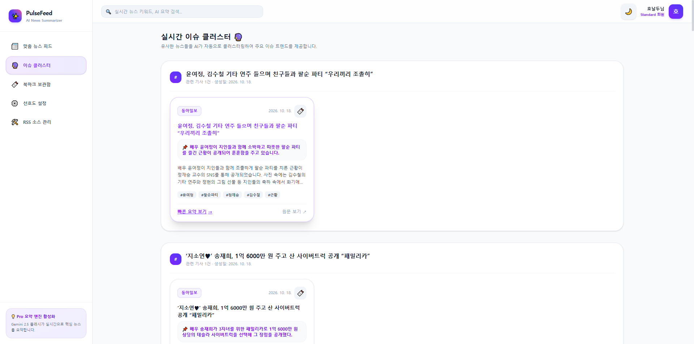
- **북마크 보관함 (`/bookmarks`)**: 관심 기사 스크랩 및 관리.
  - 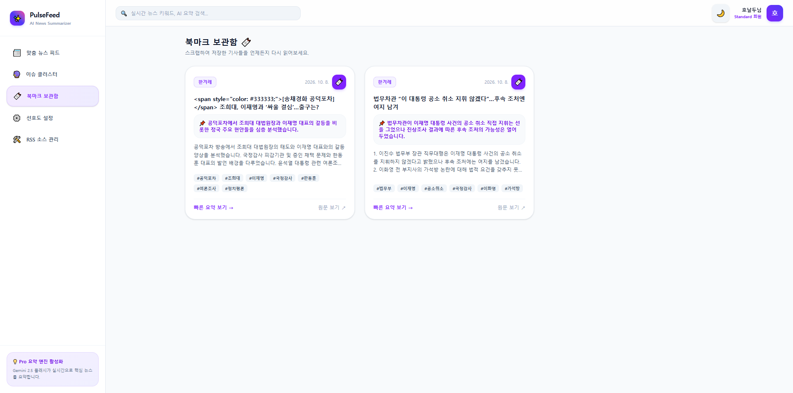
- **사용자 선호도 설정 (`/settings`)**: 관심 카테고리 다중 선택 및 맞춤형 키워드 관리.
  - 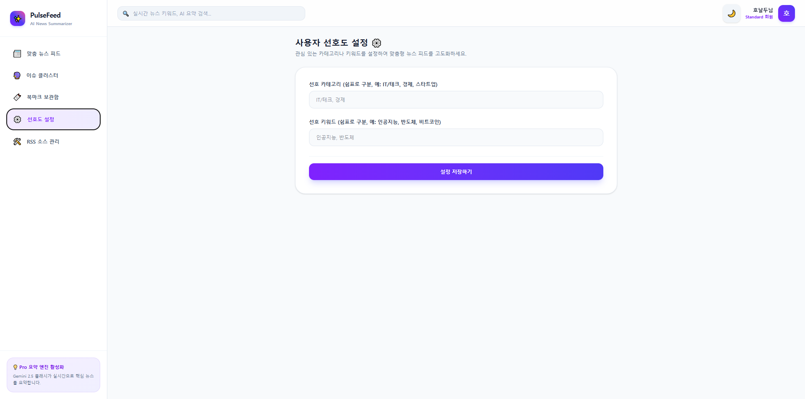
- **관리자 RSS 소스 관리 (`/admin/sources`)**: RSS 소스 CRUD 및 수동 수집 파이프라인 즉시 트리거.
  - 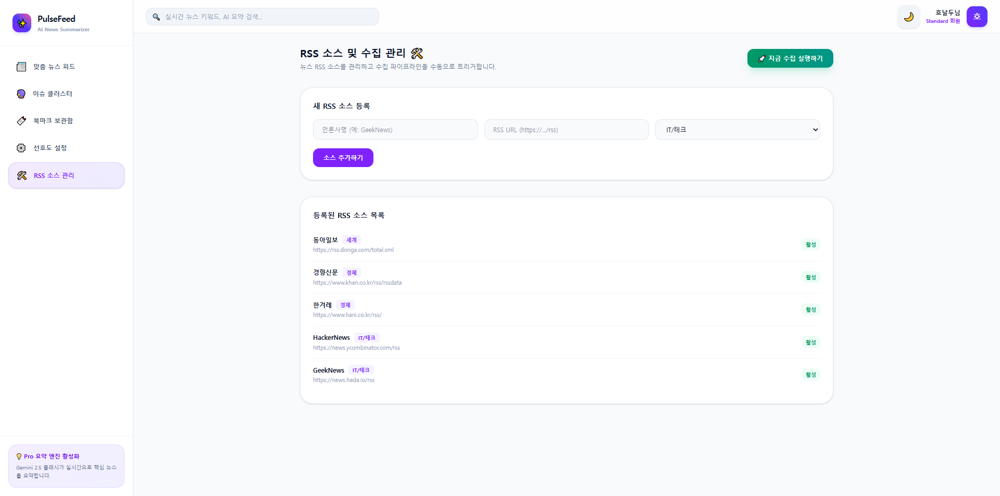